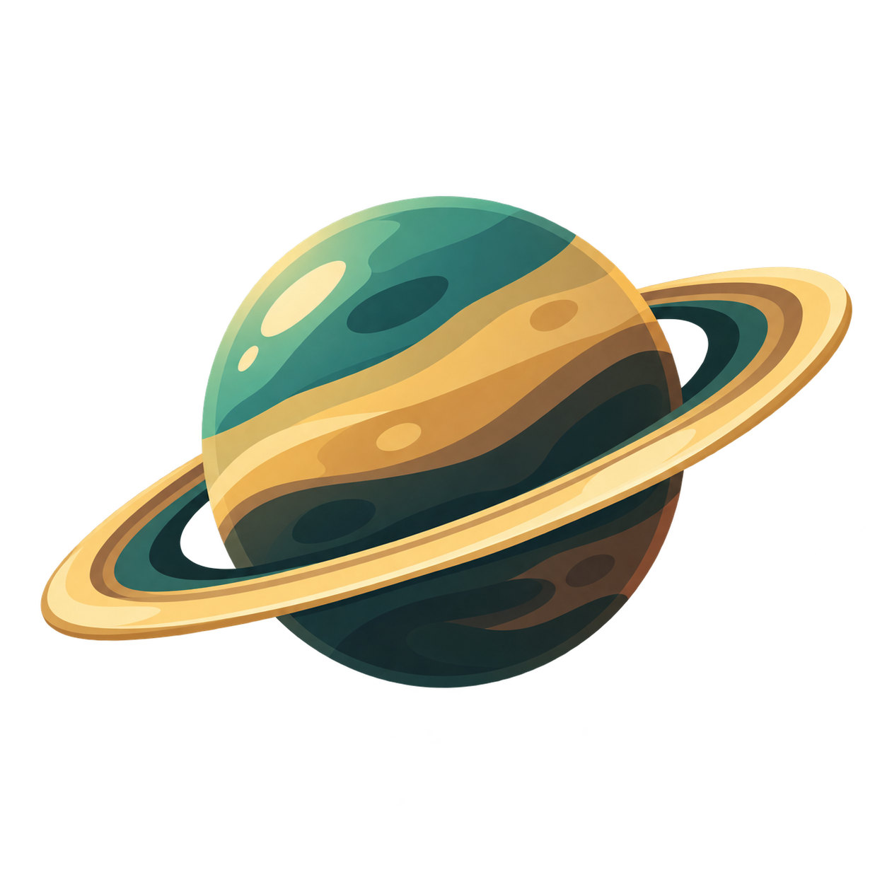
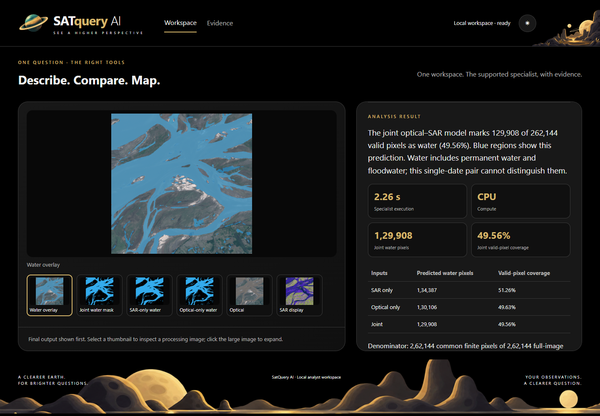
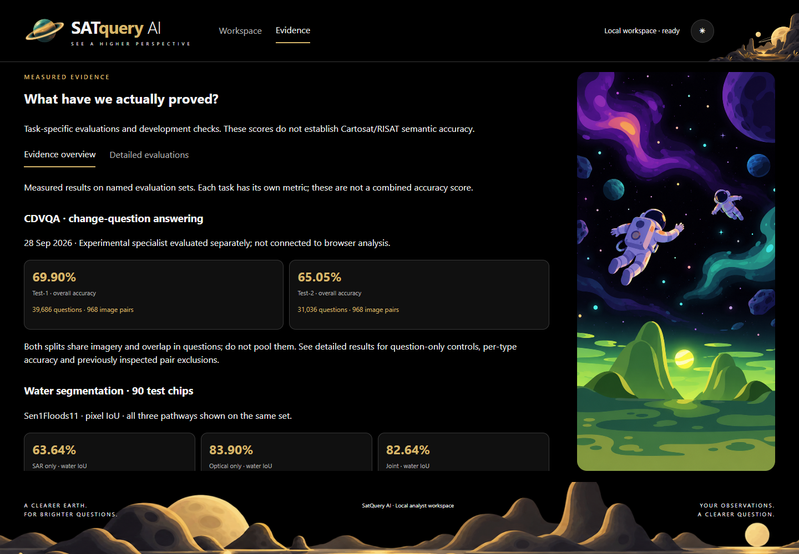

<p align="center"></p>

<h1 align="center">SatQuery AI</h1>

<p align="center"><strong>Ask about Earth. Inspect the answer.</strong></p>

<p align="center">
  <a href="docs/REVIEWER_GUIDE.md">Product walkthrough</a> ·
  <a href="#measured-evidence">Measured evidence</a> ·
  <a href="docs/SETUP.md">Setup</a> ·
  <a href="docs/ARCHITECTURE.md">Architecture</a>
</p>

SatQuery helps remote-sensing researchers and analysts ask questions about **prepared satellite imagery**, compare observed dates, and inspect the evidence behind a result. It brings input checks, task selection, specialist execution, and review into one local interface.

**Status:** local research prototype for **SIH26167**. Working analytical paths and separate experiments are described below. Model assets require additional provisioning. Documentation reviewed **27 October 2026**; measurements retain their original evaluation dates.

<picture>
  <source media="(prefers-color-scheme: dark)" srcset="docs/images/workspace-water-dark.png">
  <source media="(prefers-color-scheme: light)" srcset="docs/images/workspace-water-light.png">
  
</picture>

*Actual product screen, captured 27 October 2026 from a new run of the supplied India example. The 49.56% shown is predicted water coverage in this crop, not accuracy. [Walk through this example](docs/REVIEWER_GUIDE.md#1-map-water-and-inspect-three-pathways) · [Capture provenance](docs/images/README.md).*

## From an observation to a reviewable result

1. **Supply prepared imagery.** Upload one image or a compatible pair, or choose a supplied example. Declare the required modality and dates.
2. **Ask a supported question.** Input checks and the controller select an eligible specialist. Unsupported or ambiguous requests receive requirements or suggestions.
3. **Inspect the result.** Review the final output, switch between inputs and processing views, then inspect calculations, limitations, and downloadable evidence.

Sensor calibration, quality masks, and spatial correspondence depend on the workflow. Matching metadata alone does not prove physical co-registration. See [input contracts](docs/ARCHITECTURE.md#input-contracts).

## What you can run

These paths are connected in the main interface once their assets are provisioned:

| Input | Supported analysis | Execution |
| --- | --- | --- |
| One optical image | Visual questions, descriptions, estimated counts | Qwen2-VL; local CUDA |
| Calibrated red/NIR GeoTIFF | NDVI and thresholded pixel coverage | CPU numerical processing |
| Two prepared RGB dates | Road/building change masks and a separate caption | MCI; CPU |
| Compatible optical/SAR pair | SAR-only, optical-only, and joint water masks | WaterUNet; CPU |
| Compatible optical/SAR pair | Scene-level land-cover labels from three pathways | BIFOLD ResNet50; CPU |

**Experimental browser paths:** category grounding, single Sentinel-1 scene classification, and paired Sentinel-2 NDVI/NDWI comparison. See [capabilities and boundaries](docs/ARCHITECTURE.md#capability-status).

**Experimental CDVQA mode:** answer one of 300 supported change-question templates on an aligned, ordered RGB pair through the browser or [CLI](scripts/predict_cdvqa.py). Alignment declaration and input checks are required. The browser integration does not change the historical benchmark scores. [Report](docs/CDVQA_FINAL_REPORT.md) · [Integration review](docs/PENDING_RELEASE_REVIEW_20261027.md).

## Measured evidence

Each task has its own metric and scope. These results do not form an overall SatQuery accuracy score.

| Evaluation | Recorded result | Denominator and scope |
| --- | --- | --- |
| [CDVQA Test-1](docs/CDVQA_FINAL_REPORT.md) | **69.90%** answer accuracy | 39,686 questions / 968 pairs; experimental specialist, 28 Sep 2026 |
| [CDVQA Test-2](docs/CDVQA_FINAL_REPORT.md) | **65.05%** answer accuracy | 31,036 questions / the **same 968 pairs**, 28 Sep 2026 |
| [Water mapping](BENCHMARK_REPORT.md#water-retain-the-three-pathways) | SAR **63.64%** · optical **83.90%** · joint **82.64%** IoU | 90 Sen1Floods11 test chips; previously evaluated split, 21 Sep 2026 |
| [Road/building change](BENCHMARK_REPORT.md#temporal-segmentation-and-captions-are-separate) | Road **80.99%** · building **81.69%** IoU | 100 selected LEVIR-MCI pairs: 50 changed / 50 unchanged; inherited checkpoint, 21 Sep 2026 |

CDVQA splits overlap in questions and share imagery; **do not pool them**. Question-only controls scored 68.06% / 63.24%. Twelve pairs were previously inspected; [controls and exclusion analysis](docs/CDVQA_FINAL_REPORT.md#previously-inspected-pairs-excluded) disclose that exposure. Joint water fusion did not exceed optical-only on this test set.

[Benchmark findings](BENCHMARK_REPORT.md) · [Numerical tables](paired_lab/evidence/benchmark-20260921/metrics.csv) · [CDVQA predictions](paired_lab/evidence/cdvqa-trained-20260928/) · [Claim register](docs/CLAIM_REGISTER.md)

<details>
<summary><strong>See the in-app Evidence page</strong> — overview and detailed evaluations</summary>

<picture>
  <source media="(prefers-color-scheme: dark)" srcset="docs/images/evidence-overview-dark.png">
  <source media="(prefers-color-scheme: light)" srcset="docs/images/evidence-overview-light.png">
  
</picture>

This capture predates CDVQA browser integration. It displays saved evaluations; opening the page does not rerun the models. [Reviewer guide](docs/REVIEWER_GUIDE.md) · [Screenshot provenance](docs/images/README.md).

</details>

## Run and verify

**Start with [setup and required assets](docs/SETUP.md).** The tested target is Linux/WSL with Python 3.11. A clone does not include every asset needed for full inference.

For software checks in an activated **Python 3.11** environment:

```sh
python -m pip install -r requirements-test.txt
python scripts/check_publication.py
python -m unittest discover -s tests -v
python scripts/test_measure_landmarks.py -v
python scripts/test_quality_readiness.py -v
```

[GitHub Actions](https://github.com/Yoriichi-GOD/SATquery-AI/actions/workflows/software-tests.yml) runs these checks. Tests include mocks and synthetic inputs. Publication checks cover newly committed files and recompute saved CDVQA metrics; they do not run model inference or scan all uncommitted files.

For a provisioned runtime, follow the [launch instructions](docs/SETUP.md#start-a-provisioned-runtime) and open **http://localhost:8767**. This is a local address, not a hosted demo.

## Explore the project

| I want to… | Open |
| --- | --- |
| See the product and strongest examples | [Reviewer walkthrough](docs/REVIEWER_GUIDE.md) |
| Understand services and supported inputs | [Architecture and capabilities](docs/ARCHITECTURE.md) |
| Install dependencies and identify missing assets | [Setup](docs/SETUP.md) |
| Find active code and historical material | [Repository map](REPOSITORY_CONTENTS.md) |
| Audit measured results | [Benchmark report](BENCHMARK_REPORT.md), [CDVQA report](docs/CDVQA_FINAL_REPORT.md), [claim register](docs/CLAIM_REGISTER.md) |
| Check official-product work | [Official sample report](docs/OFFICIAL_SAMPLE_FINAL_REPORT.md) |
| Find presentation material and remaining gates | [Presentation findings](PPT_FINDINGS.md), [priority closure](docs/PRIORITY_CLOSURE.md) |
| Understand omitted assets | [Evidence storage](docs/EVIDENCE_STORAGE.md) |
| Check recent improvements and verification | [Implementation review](docs/PENDING_RELEASE_REVIEW_20261027.md), [presentation verification](docs/PRESENTATION_VERIFICATION.md) |

## Current boundaries

- **Expert review remains necessary.** Descriptions and counts can be wrong. Masks and scores are predictions. Index thresholds do not establish vegetation health or flood extent.
- **Official checks have limited scope.** Downloaded samples supported Cartosat ingestion/description execution and EOS-04 numerical calibration checks. Paired Cartosat/RISAT semantic accuracy remains unvalidated. [Exact scope](docs/OFFICIAL_SAMPLE_FINAL_REPORT.md).
- **Operational readiness is open.** Authentication, multi-user isolation, full fresh-machine inference reproduction, and deployment scalability are not established. Forecasting is outside scope.

Historical evidence and deliverables retain their existing paths. The [MIT license](LICENSE) covers repository code; model and dataset terms require their own review.

## JAI 2026 Flood & Terrain extension

New event work is on the `jai-flood-terrain-20261030` branch. The optional [Flood Intelligence integration](jai_extension/README.md) connects genuine saved Flood Lab evidence inside the existing workspace. [Verification and open failures](docs/jai/REGRESSION.md) distinguish new software checks from historical scientific results. Terrain is pending.
