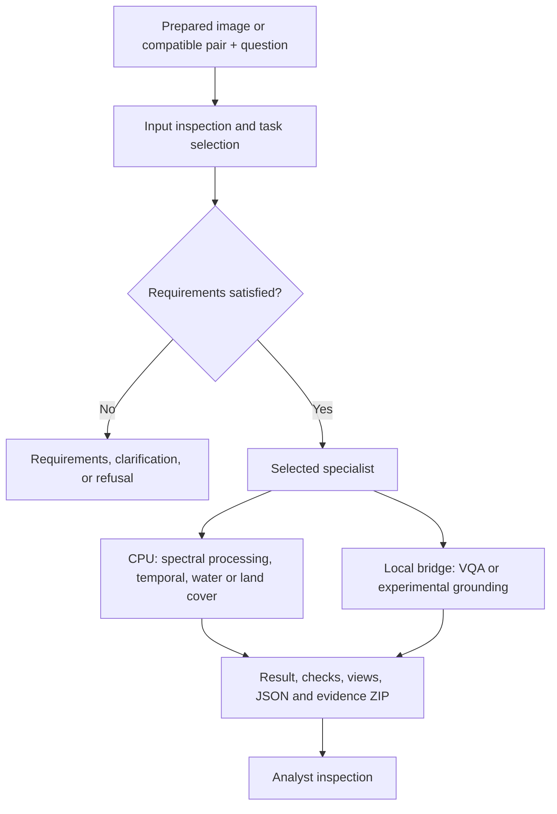

# Architecture and capability boundaries

[Overview](../README.md) · [Walkthrough](REVIEWER_GUIDE.md) · [Setup](SETUP.md) · [File map](../REPOSITORY_CONTENTS.md)

SatQuery connects bounded analyses through one interface. The controller uses the question and inspected metadata to select an eligible specialist. Paired execution stays in the unified service; single-image and grounding paths call another local service. The shared interface does not imply a shared model process.

## The execution path

This is a code-based schematic, not a recorded execution trace.

| Layer | Active source | Responsibility |
| --- | --- | --- |
| Interface | [HTML](../paired_lab/web/index.html), [JS](../paired_lab/web/app.js), [previews](../paired_lab/web/upload_preview.js) | Inputs, questions, final result, processing views and downloads |
| Unified service, 8767 | [Server](../paired_lab/server.py) | Input records, checks, one-worker execution, progress and artifacts |
| Selection | [Controller](../paired_lab/controller.py), [input contracts](../paired_lab/inputs.py), [single rules](../routing.py) | Select supported analysis or explain missing/unsupported requirements |
| CPU specialists | [NDVI](../geo.py), [spectral pair](../paired_lab/spectral_pair.py), [MCI](../paired_lab/mci.py), [water](../paired_lab/flood.py), [land cover](../paired_lab/engine.py) | Numerical calculation or learned prediction |
| Single-image service, 8765 | [Root server](../server.py), [single bridge](../paired_lab/single_bridge.py), [grounding bridge](../paired_lab/grounding_bridge.py) | Single-image inference and isolated grounding worker |
| Evidence display | [View](../paired_lab/web/benchmarks.js), [saved data](../paired_lab/web/benchmark-data.json) | Historical scores and source hashes; no inference |
| CDVQA experiment | [Model](../paired_lab/cdvqa_model.py), [CLI](../scripts/predict_cdvqa.py) | Separately evaluated template-based RGB-pair answer classifier |

**MCI is the active temporal path.** `paired_lab/engine.py` retains explicitly marked legacy ChangeFormer functions; its BIFOLD functions remain active.

## Capability status

“Available” means code exists in the published workflow, subject to assets and input requirements. It is not an accuracy certification.

| Path | Status | Interpretation boundary |
| --- | --- | --- |
| Optical VQA, descriptions, counts | Available in browser | Model interpretation; estimates and descriptions can be wrong |
| Single NDVI | Available in browser | Threshold coverage and eligible projected grid area; not health |
| Road/building temporal | Available in browser | Learned masks and separate caption; no general tracking or direction from masks |
| Optical/SAR water | Available in browser | Three masks/scores; single-date water includes permanent water |
| Optical/SAR land cover | Available in browser | Scene labels; not pixel segmentation or urban-expansion area |
| Sentinel-1 scene labels | Experimental browser path | Compatible VV/VH input; not unrestricted SAR VQA |
| Category grounding | Experimental browser path | DINO proposals and SAM masks; scores are not accuracy |
| Paired NDVI/NDWI | Experimental browser path | Valid-pixel index changes; quality masks and calibration required |
| CDVQA | Experimental CLI | Exact trained templates; outside the published browser/router |
| Software-test doubles | Verification only | Mocks, stubs and synthetic arrays; not product predictions |
| Forecasting; authentication; multi-user tenancy | Outside scope or not implemented | No operational capability claim |

Uncommitted maintainer work does not change this published capability table. Inspect the revision being reviewed.

## Input contracts

The [validation code](../paired_lab/inputs.py), each specialist, and the interface's **Input requirements** section are authoritative. Starting points:

- **Single optical:** supported RGB image/GeoTIFF preview for visual questions. Spectral measurement needs suitable bands and calibration.
- **NDVI:** eligible red/NIR values, reflectance calibration, quality/NoData handling, and suitable geographic metadata for area. Thresholds are analytical choices.
- **Temporal MCI:** corresponding 256 × 256 uint8 RGB crops, labelled bands, and ordered dates. Checks do not perform general alignment or prove physical registration.
- **WaterUNet:** prepared 512 × 512 Sentinel-1 GRD VV/VH and 13-band Sentinel-2 L1C under the Sen1Floods11 contract; sensor/units metadata and labelled bands. Common finite pixels define the denominator.
- **BIFOLD:** 120 × 120, 10 m projected input; Sentinel-1 VV/VH in dB and ten required Sentinel-2 bands in reflectance × 10,000. Band order is explicit in code.
- **Spectral pair:** dated Sentinel-2 surface-reflectance TIFFs, labelled red/green/NIR and genuine SCL, matching projected grids, and required calibration metadata. Comparison uses pixels valid at both dates.

Metadata and implemented content diagnostics cannot certify acquisition provenance, calibration correctness, or subpixel optical/SAR co-registration. Prepared benchmark examples may rely on publisher correspondence manifests without invented map coordinates. Official Cartosat/EOS-04 checks have a [separate limited report](OFFICIAL_SAMPLE_FINAL_REPORT.md).

## Evidence and deployment

Packages vary by specialist. The [unified server](../paired_lab/server.py) retains originals, checks, selected plan, tool/model traces, result JSON, and workflow-specific masks, arrays or views. The [walkthrough](REVIEWER_GUIDE.md) shows a concrete path. Historical runs do not all share a complete common schema.

The executor has one worker; concurrent multi-user service is not demonstrated. Known artifact files can survive restart, while in-memory job/upload indices do not establish persistent job history. Runtime assets still include machine-specific `/root/satquery` paths; see [setup](SETUP.md).

Model captions, masks and scores require analyst review. Detector scores, class scores and SAM predicted IoU are not measured accuracy. [Benchmark findings](../BENCHMARK_REPORT.md), [CDVQA results](CDVQA_FINAL_REPORT.md), and [evidence storage](EVIDENCE_STORAGE.md) document scope. The [acceptance protocol](ACCEPTANCE_PROTOCOL.md) describes a gate; the protocol alone does not prove it passed.
