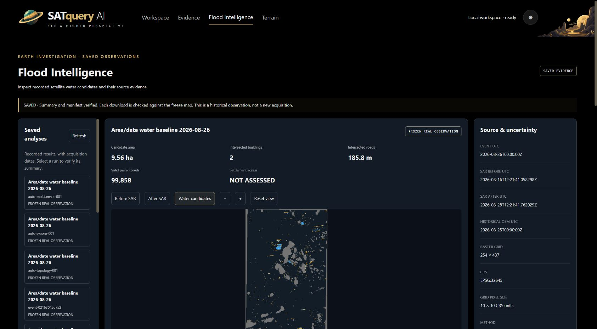
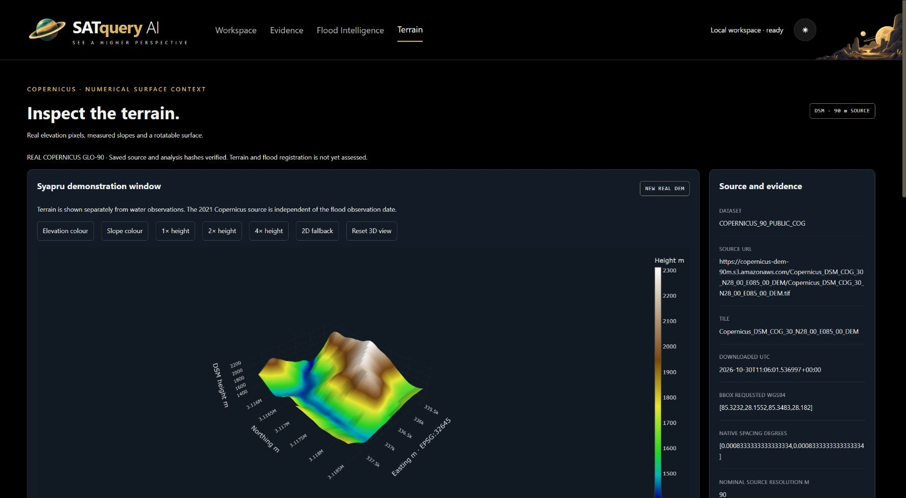

# First two build milestones — 30 October 2026

Historical checkpoint. Later alignment and investigation completion: [current record](ALIGNMENT_AND_INVESTIGATION.md).

This is a measured implementation checkpoint, not the organizer's final Day-1 submission or a claim that every item in the master prompt is complete.

## Implemented and verified

Native Flood Intelligence and Terrain tabs are added to the existing SATQuery workspace in the main repository's `jai-flood-terrain-20261030` branch. Existing specialist handlers remain intact. Both prior applications and their saved scientific results remain prior work.

Flood: loopback-only upstream; real saved-run list and normalized summary; frozen result/manifest checks; strict artifact allowlist with SHA-256 verification, MIME and size limits; actual categorical candidate preview; before/after SAR, pan/zoom, per-feature intersection table, dates, source identities and downloads. Missing connectivity assessment is NOT_ASSESSED. No iframe is used. Twenty-eight actual HTTP checks passed; 15 genuine historical artifacts matched their freeze map.

Terrain: explicitly approved public GLO-90 COG download; original/source and derived TIFF hashes; bounded Syapru crop, bilinear EPSG:32645 90m reprojection, finite/NoData mask, source extrema and percentiles, Horn slope with complete 3×3 support, cell-centred <=128×128 mesh. Actual grid: 34×28, 908/952 valid cells; elevation 1401.88–2312.73m; median slope 34.58 degrees. These are source-derived descriptions, not independent accuracy results.

Locally bundled Plotly surface renders the real grid. Elevation/slope colour, 1×/2×/4× display exaggeration, interactive rotation/zoom and camera reset are connected. A 2D numerical fallback is available. Browser camera eye changed from (+0.365,+0.365,+0.365) to approximately (+0.362,-0.213,-0.293) during the drag test, proving a real camera interaction; reset restored the default view. Source heights do not change with exaggeration.

Terrain receipt: six actual HTTP checks, exact raster/mesh matches and cell-centre roundtrips at three real points; native nearest and reprojected bilinear heights recorded separately. Their 0.82–16.37m differences are sampling differences, not vertical error against an independent survey.

## Verification scope

- Main suite: 155 passed (117 prior + 24 flood/origin + 14 terrain).
- Existing helpers: six landmark and five readiness tests passed.
- Publication evidence/hygiene check passed after the flood commit; rerun for terrain commit.
- Flood Lab baseline: 69 passed / 1 failed / 31 warnings. The unchanged older test expects uninspected reference features, while existing current readiness metadata records inspected features. This remains a disclosed baseline failure.
- Browser: real flood run selection and source preview; original Workspace navigation; 3D load and controls; real rotation; 2D fallback; 1280×720 and 1691×930 desktop and settled 390×844 layouts without document overflow. Screenshots captured from application revision e42118c are in images/, with hashes and actual timestamps in BROWSER_RECEIPT.json. No errors/warnings were captured at these checkpoints.

## Launch and stop

Current host: main baseline service remains at 8767. This extension runs at http://127.0.0.1:8768/ ; Flood Lab at 8770. Set SATQUERY_BASELINE_ROOT, FLOODLAB_BASELINE_ROOT, FLOODLAB_PYTHON and JAI_PORT=8768, then run `python start_jai.py` using the main environment. Runtime data/logs are ignored under `.runtime/jai`. The participant-operated launcher stops both children with Ctrl+C and refuses occupied ports. No cloud deployment or public listener exists.

## Remaining acceptance / deliberate limits

Multi-tool investigation and STOP/cancel trace, common-area terrain/flood overlay registration, transect, comparison/latency benchmark with declared repetitions, and final presentation are not implemented. Do not claim the agentic workflow, flood-depth estimation or improved flood accuracy.

No CDSE credentials/CCM authorization were checked; only the approved public GLO-90 path is connected. Terrain obtain currently supports one allowlisted demo window, not arbitrary AOIs. 16MiB downloads use fixed timeout and explicit retries; automated backoff/Retry-After handling and active download cancellation remain open. No independent vertical or flood truth was added. Cached terrain hashes are checked on access; cached artifacts are not source authenticity certificates.

Organizer checkpoint, latest briefing windows, team handles and T1 repository exception remain unconfirmed. No `day1-final` tag is created or claimed. User explicitly selected the main repository. See JAI_RULE_COMPLIANCE.md for the exact record.

Final outage verification: actual paused-upstream timeout cleared stale flood metrics and image; resuming restored the real run. Both services were left working. Final source milestone e42118c; later commits add documentation evidence only.

