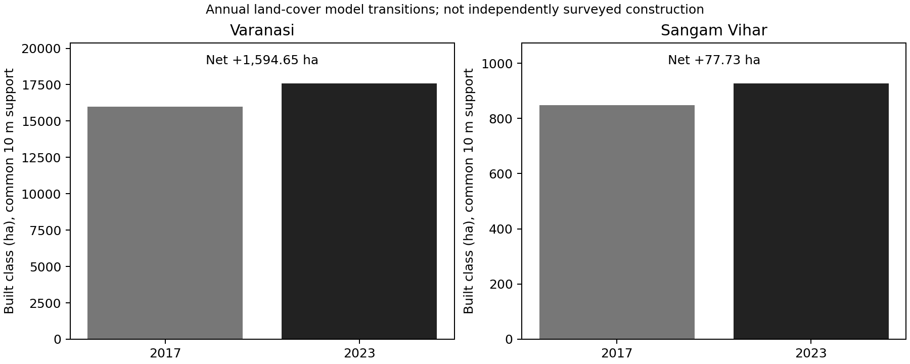
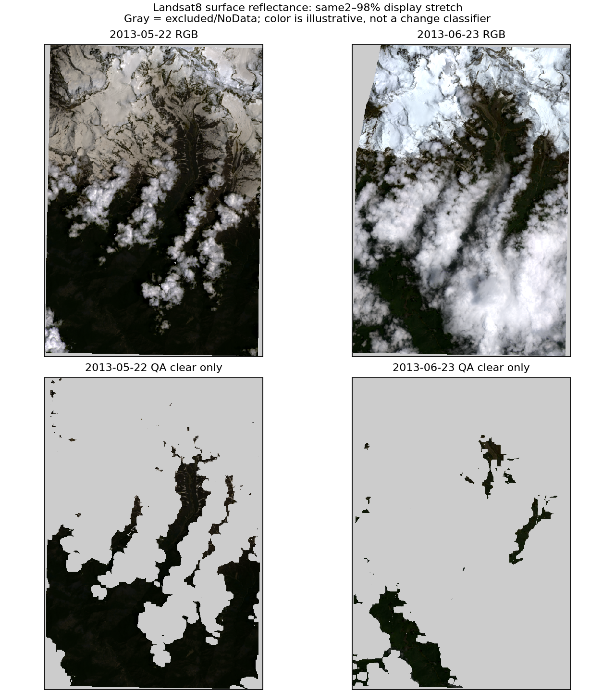
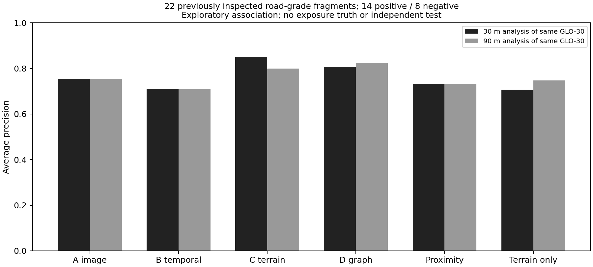

# Four-case acquired-data research release — 7 November 2026

We acquired **37 native raster windows** (12.45 MiB of compressed TIFFs), processed all four prescribed
case windows, reran Nepal's existing A–D development diagnostic with finer terrain, and retained actual
measurements, images, tables, source identities, quality failures and reproducibility checks.
**This is a measured research prototype, not a validated exposure model or a completed paper result.**

Start with [MEASUREMENTS.csv](MEASUREMENTS.csv), [case images](cases/), [comparison figures](figures/),
[machine-readable completion gates](completion.json) and [source research](sources/).
The original frozen November 5 results have not been overwritten.

## Data actually acquired and processed

| Case/window | New native windows | Actual inputs and role |
|---|---:|---|
| Nepal/Syapru | 2 | GLO30 DSM, including separately declared buffered context; existing frozen Sentinel1/2 candidate masks and Aug 25 historical OSM retained |
| Upper Mandakini/Kedarnath | 20 | Landsat8 Collection2 Level2: six reflectance bands plus two QA bands on May 22 and June 23 2013; two GLO30 windows; two NASADEM windows |
| Varanasi | 8 | IO/Esri annual LULCv02 in 2017/2023; WorldCover2020/2021; JRC GSW occurrence/seasonality; two GLO30 windows |
| Southern Sangam Vihar/Devli–Asola | 7 | Same urban products; one GLO30 window |

The boxes are exploratory analysis windows, **not** municipal, surveyed settlement, disaster, or full
upstream-basin boundaries. Exact boxes and projected coordinate systems are in [protocol.json](protocol.json).
The native-window copies, metadata, queries and provider receipts are available locally in
`research/datasets/local/campaign-20261107/`. The portable [local data manifest](LOCAL_DATA_MANIFEST.json)
records hashes for 94 source/metadata files. Runtime graphs/raster derivatives remain under
`.runtime/case-campaign-20261107/`; compact paper evidence is collected here.

No full global raster, paid API, model training or account credential was needed. Public Azure signing
tokens were used in memory and are excluded from saved URLs. Each receipt identifies the product,
source URL without query tokens, remote ETag, native grid/window, source epoch, license, local checksum,
mask and resampling. A remote ETag is not represented as a full global-file checksum.

Provider entry points: [Landsat access](https://www.usgs.gov/landsat-missions/landsat-data-access),
[NASADEM](https://planetarycomputer.microsoft.com/dataset/nasadem),
[Copernicus DEM](https://registry.opendata.aws/copernicus-dem/),
[annual LULC](https://planetarycomputer.microsoft.com/dataset/io-lulc-annual-v02),
[WorldCover](https://esa-worldcover.org/en/data-access),
[JRC surface water](https://global-surface-water.appspot.com/download).
Detailed licenses, source checks and exclusions are in the four [source notes](sources/).

## Measured urban change

Counts use the **native10 m annual class grids**, exact case ROI cell-center support, and common known
pixels. Class0/10 is unknown and excluded. Both boxes have100% common known class support for this
product; that is categorical-map coverage, not100% real-world observation accuracy.

| Annual model-map quantity,2017→2023 | Varanasi | Southern Sangam Vihar |
|---|---:|---:|
| Common support, ha | 23,208.78 | 2,388.24 |
| Built class2017, ha | 15,976.53 | 848.42 |
| Built class2023, ha | 17,571.18 | 926.15 |
| Gross nonbuilt→built, ha | 1,868.20 | 100.80 |
| Gross built→nonbuilt, ha | 273.55 | 23.07 |
| Net built-class difference, ha | **+1,594.65** | **+77.73** |

These are model-predicted class transitions, not verified construction, encroachment, drainage blockage,
or flood damage. Gross losses are retained, rather than hidden to make growth look cleaner. Stock-flow
conservation and every transition-matrix cell were checked by a separate recount. Both cases were
processed with the same fixed method, but successful processing is not validated transfer performance.
Slope/HAND summaries for resampled gain cells are descriptive context only.

WorldCover2020 v100 and 2021 v200 use different algorithms; their stocks are reported separately and their
difference is not called temporal change. JRCv1.5 occurrence is historical1984–2024 water context;
seasonality is2024 context. Neither is event-specific truth. NoData255 is explicitly excluded.

## Historical Kedarnath: a quality failure we must retain

The pre/post pair is2013-05-22/2013-06-23, path145/row039. Sentinel1/2 did not exist as observation
options for this event. Surface reflectance uses scale0.0000275 and offset−0.2. Fill, dilated cloud,
cirrus, cloud, shadow, snow and saturated pixels are excluded. The post image does not observe peak
June 16–17 inundation. NASADEM is reprocessed SRTM2000 terrain, not an event-time2013 surface.

| Quantity | Measured value |
|---|---:|
| ROI30 m pixels / sampled area | 377,658 /33,989.22 ha |
| QA-clear before | 134,735 pixels /35.68% |
| QA-clear after | 29,274 pixels /7.75% |
| Common QA-clear support | **22,582 pixels /2,032.38 ha /5.9795% of ROI** |
| New-water spectral proxy | 18 pixels /**1.62 ha**, conditional on common support |
| Fixed vegetation-loss proxy | 0 pixels on that support |
| Optical registration | **UNAVAILABLE**:757/163 keypoints,0 trustworthy mutual matches |

The water rule is MNDWI_after>0 and MNDWI_before≤0. The vegetation rule is NDVI_before>0.4,
NDVI_after<0.2 and drop≥0.25. They were fixed before viewing outputs. These are exploratory proxies;
zero vegetation-loss pixels is **not** evidence of no debris. Poor common coverage and unverified
registration prevent an event-extent, debris, or accuracy claim. Do not extrapolate1.62 ha to the whole ROI.
The earlier CEMS EMSR049 product is pre-event base mapping, not2013 flood truth. NRSC's accessible
Bhuvan landslide display is not a native independently validated vector reference in this release.

## Nepal: unchanged observations, new terrain sensitivity

The retained `event-fe47db331390` still contains 956 water-candidate pixels, **9.56 ha** on 998.58 ha valid
support, and 1,041 debris-candidate pixels, **10.41 ha** on 302.39 ha valid support. These are candidate
measurements with different support masks. Infrastructure intersections remain possible exposure,
not confirmed damage. The separate `nepal-syapru-004` response example has a different footprint and
measurements; it is never merged into these totals.

The same GLO30 source was processed at 30 m and 90 m, with an independently declared1800 m metric buffer.
The 30 m graph has 55,770 nodes,64,497 edges,597 mapped receptors and 383,871 source-component/receptor
relationships. Of those **pairs**,168 directly intersect,5,494 have a potential downstream connection,
51,843 lack evidence,102 are unresolved within one terrain cell, and 326,264 are not connected inside the
finite modeled domain. These pair counts are not unique exposed buildings or damage counts.
Independent arithmetic checks covered all 383,871 relationships,54,157 available HAND cells and eight
recomputed ranking methods. They verify software/numeric consistency, not real flood truth.

The two-cell sampling gate for 10 m features still fails with 30 m terrain. Urban5 m drains would require
≤2.5 m sampling even to pass that necessary gate; adequate sampling alone does not validate routing,
culverts, vertical accuracy or hydraulics. D8/HAND represents potential topographic drainage; no flood
depth, event discharge, debris dynamics or safe-route certification is inferred.

### Actual A–D development comparison

Same22 previously inspected road-grade fragments,14 positive/8 negative reference grades, unchanged
parameters and common support. The target is association with a source segment's reference damage
grade, **not** flood-water/debris extent or independently labeled exposure. “No visible damage” does
not mean “not exposed.” All delivered EMSR927 areas are treated as previously inspected development
or context; none is promoted to an untouched blind test.

| Method | AP,30 m analysis | AP,90 m analysis |
|---|---:|---:|
| A:post image only | .754329 | .754329 |
| B:temporal image candidate | .708117 | .708117 |
| C:temporal +terrain | **.849880** | .798886 |
| D:full shared graph | .807023 | **.823669** |
| Proximity only | .733036 | .733036 |
| Terrain only | .706650 | .747076 |

Both columns use native GLO30 information;90 m is a coarser analysis, not a second independent dataset.
At30 m,C−B=.141763 with a conditional spatial-bootstrap95% interval[.012027,.381527].
D−proximity=.073986 with interval[−.009643,.213365], crossing zero. D−C=−.042857.
These500 resamples across11 blocks do not capture reference, registration or event-to-event uncertainty;
multiple exploratory comparisons are not confirmatory hypothesis tests. Finer terrain improved C but
reduced D relative to90 m. **More graph machinery and finer pixels are not guaranteed improvements.**
H1–H3 remain unproved; we must diagnose these relationships before adding model complexity.

## Evidence tracing and novelty

The controlled typed-payload challenge ran43 trials:8 valid measurements accepted and 35 injected faults
rejected. Faults covered changed numbers, wrong units/hashes, unsupported damage interpretation,
unavailable facts and an actually tampered artifact. The ungated relay baseline intentionally has no
checks; this measures software contract behavior, not an LLM's reliability or a real analyst's error
rate. Humans=0; model trials=0. [Trials and protocol](evidence-contract/) are retained.

The [eight-comparator review](sources/NOVELTY_COMPARISON.md) finds no support for broad first-ever
HAND, source–pathway–receptor, accessibility or geospatial copilot claims. Lifeline is the closest system
comparator. A narrowly specified evidence contract, reproducible graph evaluation and abstention study
could become a contribution, conditional on independent results. Its published results were not rerun
here and are clearly attributed as author-reported.

## What closed, and what did not

1. **Research release consolidated:** current application shell +terrain research history +pinned Flood
   Lab source at`d4c917f865b295f30c712b4f0c12ed1f3849acd1`. Main and Day1 history preserved; final
   tests and HTTP receipts are in [verification](verification/). Browser visual verification remains unavailable.
2. **Nepal prerequisites partial:** finer terrain and explicit target/reference roles; registration,
   adequate feature scale and independent compatible labels still missing.
3. **Frozen A–D diagnostic executed:** both resolutions and declared ablations retained; blind validation
   has not been performed. No invented IoU/F1 for absent water/debris/exposure targets.
4. **Both urban data pipelines executed:** change matrices, terrain and water context measured. Historical
   OSM services returned406/429; mapped infrastructure/drains and independently labeled exposure remain missing.
5. **Kedarnath historical pipeline executed:** actual2013 inputs and quality failure retained; no valid
   full-event flood/debris/exposure benchmark yet.
6. **Software evidence test +novelty review executed:** human/semantic study and scientific superiority remain open.

Do next: obtain temporally matched independent change/exposure labels and surveyed urban drainage;
select additional historical cloud-screened scenes by a declared coverage rule; establish registration
and terrain suitability; freeze genuinely unseen spatial/event support; then repeat all methods and
their missing-evidence rates. Do not train another model to compensate for undefined targets.

The repeat check caught and fixed an undeclared buffered DEM entering Nepal context through a filename
glob. Input selection now uses the registered acquisition manifest; a dedicated regression protects
this boundary. The rejected run and acquisition/test failures are retained locally. Exact frozen JSONL
bytes were restored in this new checkout after Windows line-ending conversion; original records and
expected hashes were not edited. Initial component failures came from missing local fixtures and
passed after allowlisted, hash-verified provisioning. No benchmark was made green by weakening its labels.
