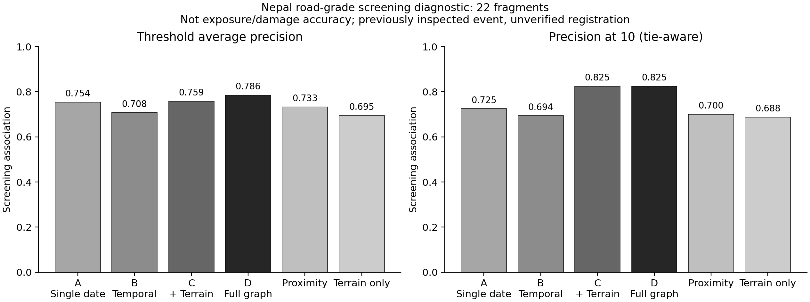
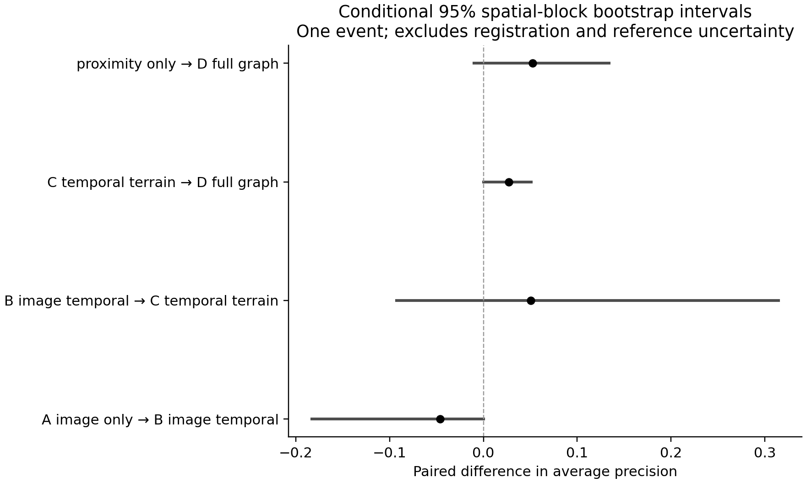
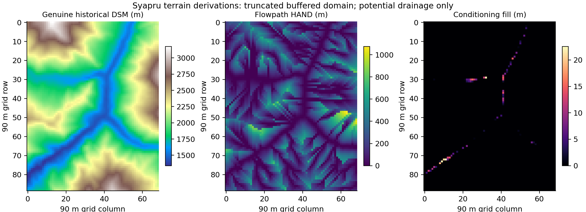

# Scientific implementation and evaluation report — 5 November 2026

**Mission status: PARTIAL. The framework is operational for coarse, inspectable screening;
independently validated exposure assessment has not been established.** No academic paper was drafted.

## Implemented

The existing SATquery application now has an additive, read-only terrain-exposure API and deterministic
investigation tool. The scientific package implements metric-grid checks, Priority-Flood conditioning,
D8 flow direction, accumulation, stream extraction, catchments, Horn slope/aspect, flowpath HAND,
and typed source–pathway–receptor evidence. Exact intersections, potential paths, same-cell ambiguity,
in-domain nonconnection and unavailable support are separate states. Ranking is ordinal and uncalibrated.

The graph preserves source hashes, times, support, methods and quality limits. Exports include normalized
graph JSON, detailed CSV, compact receptor data, WGS84 GeoJSON and metric GeoTIFFs. Genuine and synthetic
populations are separate. Public acquisition supports bounded ETag/Range downloads, source pins and STAC
discovery. Urban categorical temporal-map ingestion rejects reversed dates and incompatible grids.

Source and integration details: [API contract](../../../docs/research/TERRAIN_EXPOSURE_API.md),
[reproducible commands](../../../docs/research/REPRODUCIBILITY.md),
[method/reference audit](../../../docs/research/SOURCES_AND_METHODS.md).

## Genuine Nepal replay

- Source: unchanged `event-fe47db331390`, original 15-artifact freeze verified.
- Water: 956 candidates / 99,858 valid pixels; **9.56 ha**. Debris proxy: 1,041 / 30,239; **10.41 ha**.
- Historical DSM: 6,141 valid 90 m cells, 4 in-domain outlets,
  1,096 threshold-defined drainage cells.
- Conditioning filled 75 cells, maximum 22.523 m.
- 7,381 nodes, 24,038 edges,
  597 mapped receptors and 383,871 source–receptor rows.
- Independent verification recomputed all 6,141 cell routes, accumulation and HAND values and checked
  every relationship record and all eight ranking summaries. These are numerical consistency checks.

Relationship counts refer to source-component/receptor pairs, **not unique damaged or exposed assets**.
The declared 10 m target-width gate returns `INSUFFICIENT_RESOLUTION`. The API abstains from building/road-scale
downstream conclusions and does not treat missing observation pixels as noncandidates.

## Independent-reference experiment and ablations

EMSR927 road grades were used only for an explicitly defined inspection-ranking diagnostic. The target
is reference grading, not a water mask, debris-proxy mask, exposure truth or damage prediction.
All configurations share **22 road fragments, 14 positive and eight negative grades**, fixed reference
coverage and exclusions. Six uncertain grades and three unsupported/too-short units are reported separately.
The full D variant executes the actual graph engine with grades withheld from its geometry/flow computation.
Original reference maps had been inspected previously, so this is development replay, never an untouched test.

| Configuration | Units | Abstentions | Average precision | Precision@10 |
|---|---:|---:|---:|---:|
| A_image_only | 22 | 0 | 0.75433 | 0.72500 |
| B_image_temporal | 22 | 0 | 0.70812 | 0.69412 |
| C_temporal_terrain | 22 | 0 | 0.75861 | 0.82500 |
| D_full_graph | 22 | 1 | 0.78556 | 0.82500 |
| no_temporal_information | 22 | 0 | 0.75433 | 0.72500 |
| no_terrain_graph | 22 | 0 | 0.70812 | 0.69412 |
| proximity_only | 22 | 0 | 0.73304 | 0.70000 |
| terrain_only | 22 | 0 | 0.69482 | 0.68750 |

Boundary ties use expected inclusion; AP uses grouped thresholds. One missing D score remains an
abstention placed after observed scores for a fixed denominator. Conditional confusion counts, precision,
recall/F1 and per-unit source attributes are in [actual metrics](nepal-reference-metrics.json).
No arbitrary weighted risk score or calibrated confidence was introduced.

Temporal B is lower than single-date A in this diagnostic. Terrain C is higher than B, but its paired
95% spatial-block interval crosses zero. Full D versus proximity also crosses zero; no reliable terrain
advantage or generalization has been shown. Bootstrap uses 500 paired resamples of 11 declared 500 m
blocks within one event. It excludes reference, registration and event-to-event uncertainty.
Source-confidence ablation is unavailable because no calibrated source confidence exists.

The old mixed-class water/debris comparison results were not overwritten or promoted to accuracy.
Class-compatible segmentation/exposure scores remain **BLOCKED**, rather than producing misleading IoU.

## Registration

Synthetic known translations/rotations, low texture, masked clouds/NoData, grid mismatch and cross-sensor
refusal were tested. The genuine Sentinel-2 audit found 274 / 573
keypoints but **0 trustworthy mutual matches** under the fixed quality contract.
Common clear support was 29.910%. Status: `UNAVAILABLE`,
reason `INSUFFICIENT_TRUSTWORTHY_TIE_POINTS`. No reliable residual or correction was fabricated; sources remain unchanged.
Absolute geolocation and optical/SAR registration remain unavailable. AROSICS was reviewed, not run.

## Urban execution

Varanasi and Sangam Vihar use the same drainage implementation, genuine public GLO-90 tiles and declared
exploratory windows. Varanasi processed 29,800 cells; Sangam Vihar 3,111. All three new source hashes are pinned.
Both return `INSUFFICIENT_RESOLUTION` for a 5 m target. Four real STAC queries retain candidate imagery metadata;
responses are truncated and imagery was not acquired/processed. No genuine built-up expansion, municipal
drain-network reconstruction, illegal encroachment or validated waterlogging result is claimed.

High-resolution bare-earth elevation, georeferenced surveyed drains/outlets, suitable temporal class maps
and independent urban reference labels remain missing. A similarly named place in a Delhi map search is
not silently substituted for southern Sangam Vihar. H5 remains untested.

## Integration, reliability and analyst harness

- **287 Python tests passed**, plus six retained landmark checks, five readiness checks and five existing UI
  boundary checks. Test counts concern software correctness, not scientific accuracy.
- Actual local HTTP checks used genuine frozen Nepal data through the existing Flood Lab bridge and
  the new investigation tool. Nine of nine emitted numerical claims matched their recorded source fields;
  five of six deliberately mixed development questions abstained for scale, safety/depth or date reasons.
  This bounded source-support result is not a population routing/accuracy estimate.
- The scripted analyst harness completed **40 operations with 40 rubric matches**,
  0 human participants, and no invented analyst time/action counts. Timings exclude acquisition,
  model inference and graph preparation, and do not support human productivity or percentage-savings claims.
- UI source/styling was unchanged. HTTP checks and existing DOM contracts passed; rendered browser
  interaction was not reverified. The standalone Flood Lab pytest suite was not rerun; its source is unchanged.

## Completion and remaining dependencies

| Priority | Requirement | Status | Evidence / limit |
|---|---|---|---|
| P0 | Terrain-conditioned typed graph engine | **PASS** | nepal-replay-summary.json; independent-verification.json |
| P0 | Real DEM hydrological relationships | **PASS** | 6141 cell routing/HAND arithmetic replay; not dynamic validation |
| P0 | Infrastructure exposure relationships/exports | **PARTIAL** | Operational geometric/potential screening; 90m insufficient at infrastructure scale |
| P0 | Class-compatible independent Nepal exposure/extent validation | **BLOCKED** | Mixed-class references; no water-only/debris-proxy/exposure labels; registration unavailable |
| P0 | Controlled ablations | **PARTIAL** | Eight configurations measured on 22 reference-graded road fragments; target is screening diagnostic |
| P1 | Registration quality | **PARTIAL** | Known-transform tests pass; genuine audit has no trustworthy matches; no optical/SAR validation |
| P1 | Urban transfer | **PARTIAL** | Two genuine public DSM runs and tested categorical-map ingestion; street-scale analysis withheld |
| P1 | Reproducible execution | **PARTIAL** | Pinned CPU environment and public terrain examples; full Nepal imagery/reference sources externally provisioned |
| P2 | Analyst harness | **PASS** | 40/40 scripted operations match rubric; zero human participants; no productivity claim |
| P0 | Original evidence/application preservation | **PASS** | 287 regression tests; five UI contract checks; unchanged original main, benchmarks and day1-final |

Next scientific dependency: class-compatible independently supplied Nepal extent/exposure labels with
documented coverage, trustworthy physical registration and suitable terrain scale. Obtain surveyed urban
drains/elevations and independent labels before H5. Freeze separate geographic development/test support
before calibration. Recruit actual analysts before making human-workflow claims. No new tuning against
the inspected Nepal references should be performed under the guise of independent testing.

## Preservation and artifacts

Original main remains `fe8a038d1aebe84e1385e228749901c4a18f7f36`; benchmark reports, prediction evidence and Day 1
artifacts are unchanged. `day1-final` remains `f3945347cf0f0a4581aa1480c8fa1501a25da4b4`, tag object
`a08d2706397d359edb060993ee3a14374b3d136f`. All new commits are additive on
`codex/scientific-terrain-20261105`; no history/tag rewrite or fabricated timestamps.

Full local exports are in `research/results/local-20261105/` (ignored): approximately 79 MB graph and
115 MB detailed CSV, plus native derivatives and evaluation-unit rows. Small public review receipts/plots
are in this directory. Raw satellite products, reference archives, credentials and model weights are not
added to Git. Preliminary attempts are retained separately and are not the final metric source.

The initial clean-worktree hash failure exposed CRLF conversion of a frozen input; the exact original LF
hash was restored, and explicit checkout attributes now preserve those bytes. The first graph JSON was
oversized; normalized export reduced the interactive payload without silently dropping relationship rows.
Both findings and the negative scientific results were retained.

Closing checks also served the original cached terrain scene and raster with its exact retained SHA-256.
Publication checks used Windows Git for this Windows-created worktree; WSL Git cannot resolve its Windows .git pointer.
The Windows check passed and reproduced both original CDVQA split/control summaries unchanged.
