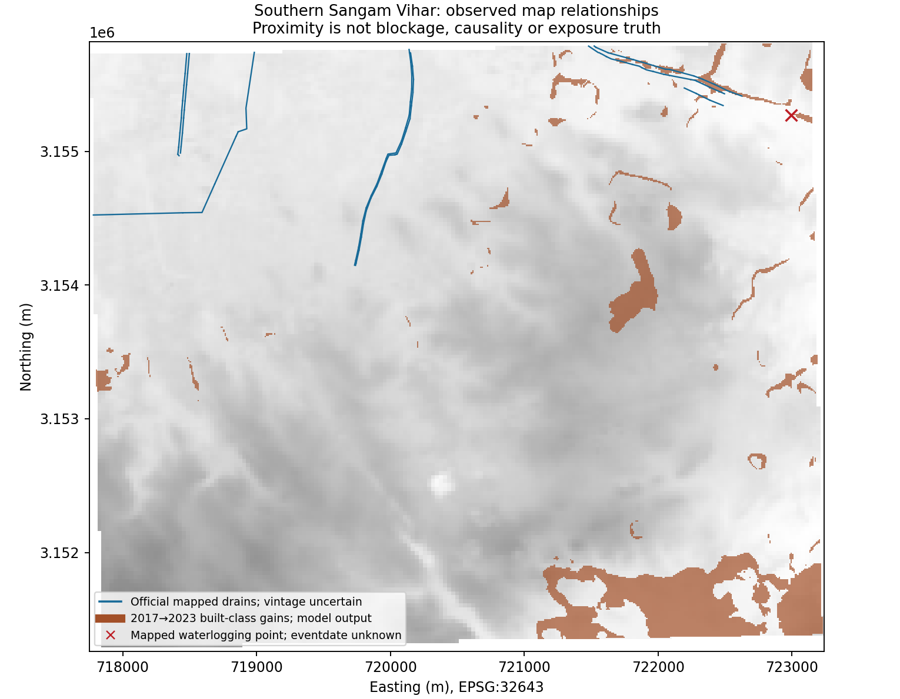
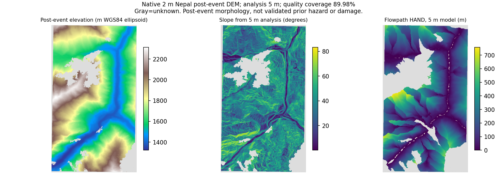
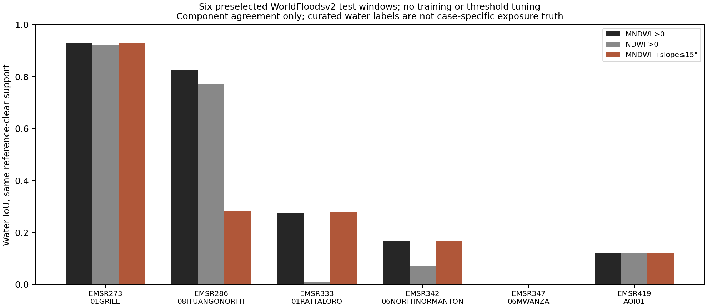
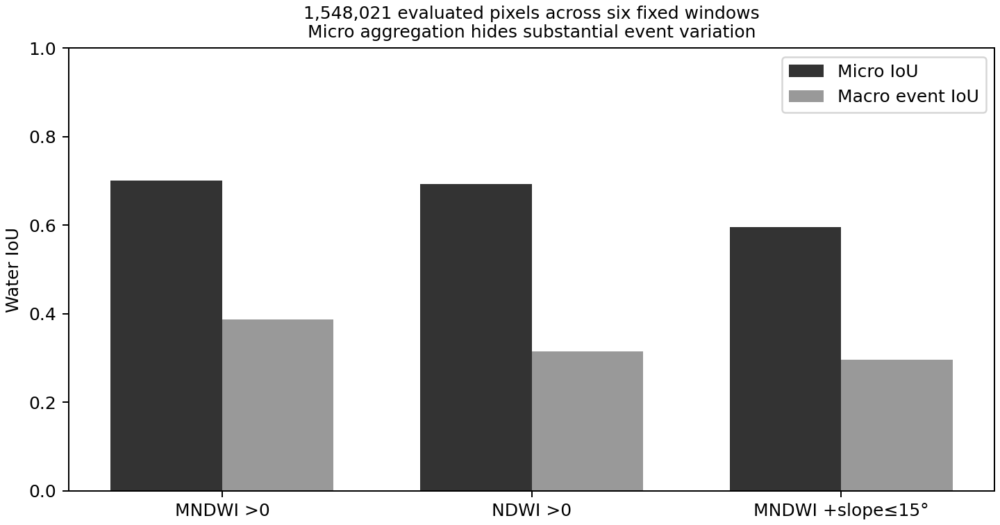

# Validation closure campaign — 7 November 2026

This release advances the prerequisites that remained open after the [four-case campaign](../case-campaign-20261107/REPORT.md).
It acquired native official Delhi drainage geometry, a native 2 m post-event Nepal terrain crop, and a
new six-event external water-component test. It also executed quality-only historical scene selection
for Kedarnath. **Case-specific exposure accuracy, physical sensor registration and broad novelty remain unproved.**
The previous campaign and its measurements are unchanged; this is a separate evidence pack.

## What actually changed

| Requirement | New evidence | Current limit |
|---|---|---|
| Independent labels | Six predeclared WorldFloodsv2 test windows scored after predictions were sealed | Curated total-water component labels; not four-case exposure or new-water truth |
| Suitable terrain | Genuine 2 m post-event stereo DEM crop over Syapru, analyzed at 5 m and 30 m | Quality coverage 89.98%, below 95% gate; after-event vintage, no local surveyed accuracy |
| Urban drainage | Native southern Sangam Vihar storm drains, sewers, water lines, colony boundaries and one waterlogging point | Official map is not guaranteed ground verified; mixed/unknown epochs and positive-only waterlogging |
| Registration | Stronger uncorrected-alignment acceptance gate and quality-only Landsat search | No eligible replacement pair passed the fixed coverage gate; absolute/SAR–optical registration still absent |
| Withheld support | One newly scored six-activation component test; four further activations reserved unopened | First test now consumed; no pretending a rerun is fresh; reserve not case-specific exposure validation |
| Scientific benefit | Terrain filter tested on exactly the same support as spectral baselines | The simple terrain filter harmed aggregate water performance; no universal benefit claim |

## 1. Official southern Sangam Vihar drainage is now available locally

The public [GSDL Sangam service](https://gsdl.org.in/arcgis/rest/services/DIFC/sangam/MapServer) exposes native
storm drains, sewer and water lines, and colony polygons. Every feature intersecting the original
`[77.225,28.47,77.28,28.51]` envelope was queried by object ID, fetched in bounded batches, and checked
for missing or duplicate IDs. Native geometry was requested in EPSG:32643. No features were hand-picked.

The envelope query returned 90 storm-drain features, 288 updated sewer-line features, 784 updated
water-line features, 874 sewer-line features and 696 water-line features. These overlapping inventories
are **not summed into a fabricated count of unique utilities**. Exact ROI clipping leaves 83 drain
features with positive intersection; native mapped geometry unions remove exact line overlaps.

| Quantity | Measured value |
|---|---:|
| Unique clipped Sangam storm-drain length | **9,648.16 m** |
| Separate Aug2024 agency-map drain length | **12,748.26 m** |
| 2017→2023 gross modeled built-class gain | 100.80 ha |
| Gain within 30 m of Sangam drains | **3.6463 ha** |
| Gain within 90 m of Sangam drains | **4.3612 ha / 4.33%** |
| Gain within 150 m of Sangam drains | **4.8743 ha** |
| Gain within 90 m using the separate agency inventory | **6.7598 ha / 6.71%** |
| Reported positive drain-width median | **1.0 m** |

The inventory difference is retained as source uncertainty. The distances were fixed before measuring;
no buffer was selected for an impressive result. These numbers describe proximity between mapped
drains and annual model-class transitions. They do not establish encroachment, blocked capacity,
waterlogging causality, safety, or confirmed exposure. The original net built-class change remains
**+77.73 ha**; gross gain and net change are different quantities.

Five intersecting drain records carry update string `28Dec20`, 23 carry `9march21`, and 55 have blank
update strings. An update field is not a verified construction or survey date. Published width,
depth/invert fields are retained, with nonpositive/null entries treated as unavailable; their field names
do not prove a harmonized vertical datum. A median 1 m drain would need ≤0.5 m sampling even to pass
the declared two-cell sampling rule. The 30 m DSM cannot resolve these drains.

At 30 m analysis, the median sampled mapped-drain-to-DSM-stream distance is 90.35 m; the reverse
model-stream-to-mapped-drain median is 1,059.60 m. These asymmetric quantities measure different
populations. Drainage-map incompleteness and engineered channels preclude calling either precision
or recall. At 90 m analysis the corresponding medians are 93.22 m and 1,139.09 m.

The [official waterlogging layer](https://gsdl.org.in/arcgis/rest/services/DIFC/DIFC_portal_data/MapServer/41)
contains one point in the ROI, with no usable event-date/negative-label denominator. It cannot close an
exposure benchmark. [GSDL's disclaimer](https://gsdl.org.in/) leaves accuracy/completeness and ground
verification to supplying departments. Native redistribution terms were not established, so raw
geometry remains private locally. [Source receipt and measured summary](delhi/summary.json).

## 2. Nepal now has genuine finer terrain, with explicit quality and vintage gates

The [Shean–Bhushan Rasuwa terrain release](https://doi.org/10.5281/zenodo.22842746) supplies 2 m optical
stereo products from 27 August–8 September 2026. They are post-event observations, in EPSG:32645
with WGS84 ellipsoidal heights. They are **not interchangeable with pre-event terrain or EGM2008
orthometric GLO30 elevations**. The release's avalanche interpretation is not independently established
as the initiating mechanism of the retained SATQuery event.

A 134,105-byte archive-directory/TIFF-header audit first established the raster envelope and native
posting. The ZIP stores its COG members without extra compression, allowing HTTP-range extraction.
The 1.5 GB archive was not downloaded wholesale. The native elevation crop contains 2,758,392 pixels;
its compressed local TIFF is 9,379,799 bytes. The matching input-count crop is 159,991 bytes.
The fixed ROI contains 2,669,952 native cell centres.

| Native quality quantity | Measured value |
|---|---:|
| Raw valid terrain pixels | 2,656,664 / **99.5023%** |
| Valid pixels with reported composite input count ≥2 | 2,402,436 / **89.9805%** |
| Full-case coverage gate | **Failed: minimum 95%** |
| 5 m analysis cells | 442,244 total; 384,261 valid |
| 10 m target's necessary sampling gate at 5 m | Passed **only the sampling gate** |
| Mapped receptors fully inside the native quality footprint | **576 / 597** |
| Mapped receptors partly inside it | **21 / 597** |

Reported composite input count is not independent stereo-pair count or calibrated accuracy. The
provider warns of cloud-edge artifacts, gaps and a biased southern strip in one input. Passing a
sampling rule does not solve those issues or physical registration. The full-case coverage gate remains
failed; post-event topography may encode disaster consequences, causing leakage in a prior-hazard study.

The unchanged water mask still measures **9.56 ha**; terrain-quality support is available at 783 of
956 candidate-cell centres (**7.83 ha**). The unchanged debris mask still measures **10.41 ha**; terrain
support is available at 1,038 of 1,041 centres (**10.38 ha**). These are coverage subsets, **not revised
hazard areas**. Receptor support fractions use exact native quality-footprint intersections; candidate
support uses nearest sampling at original 10 m cell centres. [Detailed support receipt](nepal-2m/saved-observation-support.json).

Conditioning, D8 and HAND were executed on the quality-filtered terrain at 5 m and 30 m. The 5 m run
contains 2,712 derived stream cells and 340,098 available HAND cells. No full component×receptor graph
was generated, no exposure accuracy was calculated, and no automatic source correction was applied.
This is usable **post-event morphological context on known support**, not a validated prediction upgrade.

## 3. A genuinely new local test of the water component was executed

Sen1Floods11 was rejected as a fresh holdout because SATQuery has already trained/evaluated on it.
Instead, [WorldFloodsv2](https://huggingface.co/datasets/isp-uv-es/WorldFloodsv2), revision
`1f3faa2989e69930ac31d5c0a79fd224461123f8`, supplied six fixed native 512×512 centre windows, one per
predeclared public test activation: EMSR273, 286, 333, 342, 347 and 419. EMSR264 was excluded because
its aggregate annotation metadata had been inspected during access research. No selection used water
content or prediction scores. The selection/threshold protocol was committed as **0d75d76 before
selected annotation pixels were acquired**.

Three optical bands and native GLO30 slope produced fixed MNDWI>0, NDWI>0, MNDWI>0 with slope≤15°,
all-land and all-water predictions. **All six prediction files and hashes were sealed before any selected
annotation pixels were read.** The reference's clear/known mask was used only for scoring. Every method
uses the same finite-spectral-and-terrain support. No model, threshold fitting or training was introduced.

WorldFloodsv2 combines mapped flood/hydrology and JRC permanent water, with cloud/invalid layers.
It is curated total-water reference agreement, **not new-water detection, field truth, exposure, or the
full A–D experiment**. Source/optical dates differ by about 5.72 days for EMSR273 and 3.01 days for
EMSR419; the other four are approximately coincident. These discrepancies are retained in the
[date audit](verification/independent-recount/reference-date-audit.json). Upstream global exposure to
public data is unknown. All six samples are now consumed evaluation material; later method changes
must treat them as development, not call another run blind.

| Method | Micro water IoU | F1 | Precision | Recall | Macro event IoU |
|---|---:|---:|---:|---:|---:|
| MNDWI>0 | **.700446** | .823838 | .864102 | .787159 | .386842 |
| NDWI>0 | .692602 | .818387 | .961950 | .712111 | .315721 |
| MNDWI>0 and slope≤15° | **.596378** | .747164 | .856891 | .662348 | .296377 |
| All-land control | .000000 | .000000 | unavailable | .000000 | .000000 |
| All-water control | .101320 | .183997 | .101320 | 1.000000 | .100503 |

Denominator: **1,548,021 pixels**, including 156,845 reference water pixels, across six small event
windows. Pixel totals are not independent event trials. The all-land control achieves 89.87% raw
accuracy with zero water IoU, illustrating why headline accuracy is inadequate here. Micro versus
macro IoU differs substantially; neither is hidden.

The slope filter removes 2,067 false-positive pixels but also removes **19,576 true-positive water
pixels** relative to MNDWI alone. The major loss occurs in the Ituango window. We retain the negative
result, do not tune the slope threshold on these samples, and do not present coarse terrain as a
universal water mask. A useful research contribution must specify where terrain helps **exposure
reasoning** and where blanket terrain filtering breaks detection.

Four additional activations have a separate [unopened reserve declaration](protocols/worldfloods-reserve-20261107.json).
Their annotation pixels and aggregate label metadata were not acquired in this campaign. This is a
local workflow reserve, not an assertion of globally secret data or proof of geographic disjointness.
It must be consumed once only after the next method is frozen.

## 4. Registration prerequisites were tightened, not waved through

The new acceptance helper explicitly checks **held-out pre-correction p95 displacement ≤1.5 pixels**.
A low residual after fitting a transformation cannot certify the original uncorrected pair. Even a
passing result would describe relative shared visible features, not surveyed absolute or SAR–optical
alignment. Tests cover known shifts, missing support, false interpretation and band-order corruption.
The existing frozen optical method and its failed case audits were not overwritten.

For Kedarnath, the fixed search considered Landsat8 Tier1 path145/row039 observations from
18 June–15 September 2013. The declared rule required complete catalogue footprint coverage and
≥25% common QA-clear support against May22. Only August26 and September11 fully covered the
rectangle. August10 covered 99.9989%, July9 covered 99.8585%, and June23 covered 98.3136%; they
remain excluded under the strict declared rule. July25 was Tier2. This is a catalogue-footprint rule,
not an assertion that every excluded pixel lacks a radiometric value.

August26 reached **19.5643%**, September11 **6.2279%** common clear coverage. Neither qualified.
No reflectance change result or replacement registration pass was manufactured for this search.
The earlier June23 pair's 5.98% common-clear result and failed registration remain unchanged.
These two-date measurements cannot establish the June16–17 peak extent. [Selection/exclusions](kedarnath/selection.json).

## Verification, decisions and next gates

**312 main tests and 86 Flood Lab tests passed.** A separate recount reproduced all 30 external
event/method confusion rows, their aggregate counts and the 9,648.16 m native-drain union. It initially
caught an ordering error in the verifier: JSON object keys had been sorted, while raster bands have an
explicit saved order. The verifier now uses that declaration and a regression prevents recurrence.
The predictions, references and measured scores were not changed to fix the verifier. The initial
failure is retained. Original Nepal's 15 frozen hashes were checked before coverage assessment.

The previous temporary environment had disappeared. Exact pinned dependencies were rebuilt in
`.runtime/validation-env`, with the baseline 302 tests passing before new acceptance tests were added.
No model packages or weights were downloaded. New raw windows/geometry, including licensed/private
reference content, stay under `research/datasets/local/validation-20261107/`; their hashes are in
[LOCAL_DATA_MANIFEST.json](LOCAL_DATA_MANIFEST.json). Derived review receipts and figures are here.
Browser rendering and new specialist model inference were not run for this research-only change.

**Stop doing:** blanket slope exclusion as a supposed universal improvement; recycling inspected
Nepal/Sen1Floods11 as untouched tests; using post-event terrain as a prior-event causal input; calling
proximity, positive-only waterlogging or damage grades independent exposure truth.

**Next required evidence:** temporally matched positive/negative infrastructure exposure labels;
independent physical alignment controls; locally verified terrain/drain topology and epochs; and
predeclared event/spatial transfer support. No usable matched case-specific exposure target was acquired
for Varanasi or Kedarnath during this campaign. Broad novelty stays unproved: the prior eight-system
review remains the governing comparison. Better data access and an honest negative ablation improve
the research foundation; they do not by themselves prove H1–H4.
